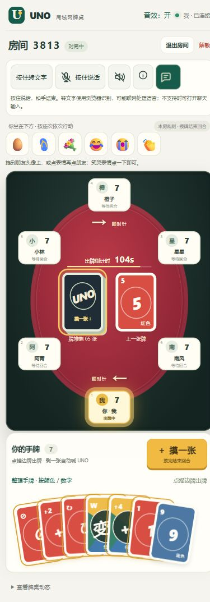
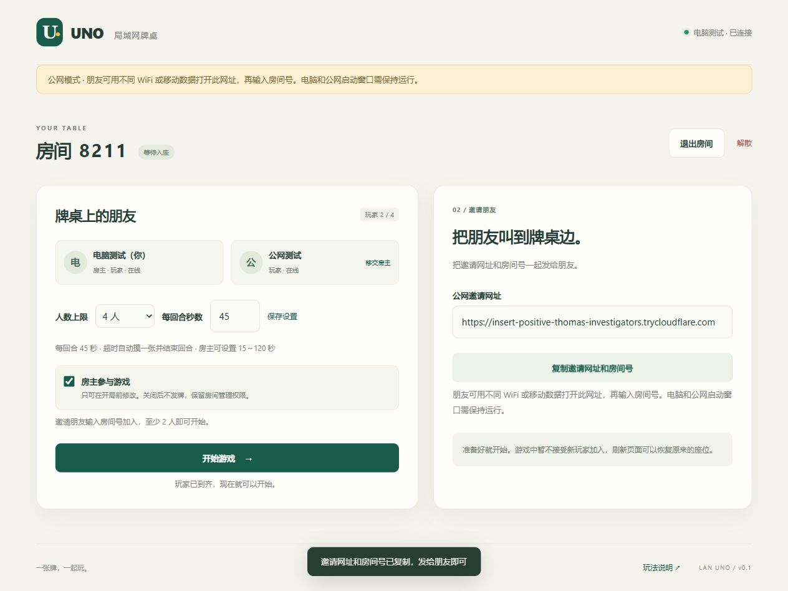

# UNO · 局域网牌桌

一个能直接运行的 Web UNO：你的电脑启动 Node.js，同局域网的朋友可直接加入；开启公网模式后，不同 WiFi／移动数据上的朋友也能用浏览器加入。

完整设计与后续计划见 [DESIGN.md](DESIGN.md)。

更新代码后请先停止原服务，再运行 `npm start`，所有设备刷新页面并重新建房。网页资源在服务启动时加载，单独刷新网页不会加载尚未重启的服务端版本。

本轮整合来自同事 [PR #1](https://github.com/cch0419/lan-uno/pull/1)（`f291869`）：语音／听筒、文字聊天、快捷短语、8 款内置表情包、图片/GIF 发送和游戏音效。另加入按住转文字的头顶气泡、可拖向头像的鸡蛋／拖鞋／鲜花、自身笑哭／鼓掌，以及可选自动 UNO。保留当前的房主规则设置、扇形手牌与抓漏／+4 质疑。

手机圆桌预览：



## 快速开始

需要 **Node.js 24 或更新版本**。在当前项目目录执行：

```powershell
npm ci
npm start
```

依赖已经安装过时，直接 `npm start` 即可。Windows 推荐双击 `start.bat`：缺少依赖时会自动安装，服务启动成功后会自动打开默认浏览器中的电脑端管理入口。

## 不同网络联机：自己的电脑当服务器

跨网方案已写入 [DESIGN.md](DESIGN.md) 的“跨网络联机补充设计”。游戏继续在你的电脑运行，不需要部署云端游戏服务器。

### 第一次准备

1. 从 [Cloudflare 官方下载页](https://developers.cloudflare.com/tunnel/downloads/) 下载 cloudflared。普通 Windows 64 位电脑选择 Windows amd64 可执行文件。
2. 将文件重命名为 `cloudflared.exe`，放进本项目的 `tools` 文件夹。若该文件已在，无需重复下载。也支持安装到 PATH，或用 `CLOUDFLARED_PATH` 指定完整路径。
3. 依赖未安装时先执行 `npm ci`。朋友不需要安装任何工具。

### 每次开局

先停止之前的 UNO 服务，随后双击 **`start-internet.bat`**，或运行：

```powershell
npm run start:internet
```

- 电脑会自动打开 `http://localhost:3000` 管理页。建立公网入口时，大厅会显示“正在连接”。
- 入口就绪后，大厅自动出现 `https://随机名称.trycloudflare.com` 公网邀请网址，无需重启 Node 或重建已创建的等待房间。
- 创建房间后点击 **“复制邀请网址和房间号”** 发给朋友。朋友打开链接、输入昵称和房间号，就能从其他 WiFi 或移动数据加入。
- 电脑房主仍可取消勾选“房主参与游戏”，自己用手机作为玩家加入。
- 保持电脑开机、唤醒、联网，保持公网启动窗口运行。按 Ctrl+C 停止本次 Node 服务及它自己启动的隧道。
- 每次重开临时网址可能变化，需要重新分享。不同网址不会继承浏览器身份。

公网工具异常退出时，大厅会停用旧邀请链接，局域网服务仍可使用。重新建立入口可停止当前窗口后再运行公网启动命令。短暂上游故障由游戏心跳和自动重连反馈，界面不保证即时检测所有隧道故障。

Quick Tunnel 是第三方公网中转，适合朋友试玩，不保证持续可用。四位房间号用于找房间；知道公网网址的人也能访问。所有规则、手牌和房间状态仍由你的电脑处理，Node 重启后房间清空。

### 排查

| 问题 | 处理 |
| --- | --- |
| 找不到 cloudflared | 确认是可执行文件，并位于 `tools/cloudflared.exe`；终端会显示官方安装地址 |
| 端口已占用 | 先关闭旧 `npm start` 窗口；公网启动已同时运行游戏，不用另开一份 |
| 长时间连接中 | 查看终端错误，确认网络能连接 Cloudflare；检查 `.cloudflared` 下是否存在影响 Quick Tunnel 的配置，不要直接删除自己的配置 |
| 网页能开但进不了房间 | 确认使用最新 HTTPS 公网网址，检查终端中的 WebSocket／Host／Origin 相关错误 |
| 某些朋友打不开 | 让对方切换移动数据测试；不同运营商和网络可能阻断隧道，需要真实跨网验收 |
| `Unauthorized: Tunnel not found` | Cloudflare 拒绝了当前临时隧道标识；程序会停用旧网址并停止无效隧道。先按 Ctrl+C 停止公网窗口，再运行 `npm run start:internet`，重新建房并分享新网址。单凭此日志不能确定为专网拦截 |
| 按钮无法自动复制 | 页面会选中网址，长按或按 Ctrl+C 复制，再单独告知房间号 |

已有手动运行的隧道时，也可以仅配置它的准确 HTTPS 网址，再正常启动游戏：

```powershell
$env:UNO_PUBLIC_URL = 'https://你的实际隧道域名'
npm start
```

此方式不管理隧道生命周期，你需要自行运行隧道。该配置不能包含路径、查询参数、凭据或通配符。自动 `start:internet` 模式会取得新地址，不使用旧的 `UNO_PUBLIC_URL`。

回到纯局域网模式时，关闭公网窗口，在新终端运行 `npm start`。若当前终端设过手动网址，先执行 `Remove-Item Env:UNO_PUBLIC_URL -ErrorAction SilentlyContinue`。

项目自带 `.npmrc`，把 npm 缓存放在当前目录的 `.npm-cache`，并使用官方包仓库。无需修改全局 npm 配置或升级 npm。

启动终端会显示：

```text
本机管理：http://localhost:3000/
局域网：http://你的内网IP:3000
```

1. 主机浏览器自动打开本机管理入口，输入昵称，创建房间。
2. 朋友打开终端显示的**局域网地址**，输入自己的昵称和 4 位房间号。
3. 至少 2 人在线时，房主开始游戏。
4. 本局结束后，房主返回大厅即可再开一局。

### 电脑只开服务器，自己用手机玩

创建房间前取消勾选 **「房主参与游戏」**；也可在等待大厅中修改这个开关。

- 电脑上的房主只管理和旁观，不占 2～10 个玩家席位、不发牌、不参与回合。
- 自己和朋友分别用手机打开主机的局域网地址，以玩家身份加入同一房间。实际参赛玩家至少 2 人才能开局。
- 电脑上的房主仍可开始游戏、移交房主、解散房间和在结算后返回大厅。开局后不能切换参与状态。
- 房主网页离线或退出不会影响正在进行的对局，管理权限会移交给其他在线成员；只有实际参赛玩家掉线才暂停游戏。移交管理权限不会自动改变任何人的参赛状态。
- **电脑上的 Node.js 进程仍要保持运行。** 关闭网页可以继续玩，关闭服务终端、让电脑休眠或关机则所有设备都会断线。

其他设备不能使用主机的 `localhost` 或 `127.0.0.1`。如果启动时显示多个网卡地址，选择真实 WiFi/以太网连接的 IPv4；可通过 `ipconfig` 确认。

首次安装依赖需要网络，运行游戏不需要互联网，页面没有 CDN、外部字体或在线资源。

### 安装报 EPERM / ENOTEMPTY 怎么办

如果错误包含 `D:\Vue\NodeJs\node_cache`，说明系统的 npm 缓存目录不可写。项目 `.npmrc` 已避开这个目录；确认在本项目目录执行命令。也可显式指定：

```powershell
npm ci --cache .npm-cache --registry=https://registry.npmjs.org/
npm start
```

如果仍报 `node_modules\ws` 的 `ENOTEMPTY`，先在正在运行本游戏的终端按 Ctrl+C 停止服务，再重新执行安装，避免文件正在使用。不需要因为 npm 的“有新版本”通知而执行 `npm install -g npm`，升级 npm 不会解决原缓存目录的权限问题。

如果自动打开浏览器失败，可手动访问终端中的本机管理地址，服务仍会正常运行。仅在不希望打开浏览器的部署中，可用 `node server/index.js --no-open`，或将环境变量 `UNO_OPEN_BROWSER` 设置为 `0`。

如果提示端口已被占用，通常是旧的游戏服务还在运行。先在原服务终端按 Ctrl+C，再重新启动；不要同时开两个使用相同端口的服务。

## 已实现

- 原生 HTML/CSS/JavaScript，Node.js + ws；HTTP 与 WS 共用端口。
- 昵称、随机恢复令牌、刷新重连、同浏览器新标签接管。
- 4 位编号房间，2～10 人，人数设置、房主移交、退出和解散。
- 房主可选择是否参赛；仅管理模式支持额外容纳 10 名实际玩家。
- 经典 108 张牌，每人初始 7 张；数字、跳过、反转、+2、变色和 +4。
- 本房规则：数字牌同色或同数字；彩色功能牌只跟当前颜色，黑色牌可跨色。保留双人规则与特殊起始牌处理。
- 主动摸一张后立刻结束回合，不允许立即打出新牌，没有跳过／弃牌操作；内部弃牌堆正常回收洗混。
- 默认自动喊 UNO，并显示动画和播放本地 UNO 音效；房主可关闭自动模式，恢复手动声明与抓漏罚抽 2 张。
- +4 冒险使用、接受或质疑；证据只发给质疑者。
- 逐名完赛，已完赛玩家退出轮转，直到仅剩一人再显示完整排名、返回大厅。
- 服务端出牌倒计时：默认 45 秒，房主在大厅可设 15～120 秒；超时自动摸一张并结束回合。
- 私有手牌视图、命令校验、请求去重、消息限速、心跳。
- 短暂掉线暂停与恢复、60 秒超时处理。
- 手机优先圆桌：自己固定下方，按座次围坐，当前玩家发光高亮，上下箭头显示方向。
- 慢速摸牌／出牌飞牌动画（单张约 1 秒），UNO 与回合提示，跳过／+2 座位印章，变色／+4 中央特效；每回合预留 2.2 秒动画缓冲。
- 深色矩形外框、四色圆桌；精简中央重复文字，保留座位高亮与倒计时。手机扇形手牌，牌多自动分排，数字角标保持可读。
- 整理手牌：按红／黄／绿／蓝／黑排序，同色数字升序，再排功能牌；位置变化带平滑动画，只改变自己的显示顺序。
- 房主开局前可设置默认／个人回合秒数、起始手牌 3～10 张、抓漏、+4 质疑和同功能牌跨色匹配。

## 规则与产品约定

房主在大厅可保存统一时间与每位玩家的单独时间，个人时间留空继承默认；起始手牌数和规则开关与时间一起保存，开局后本局固定。所有成员都能看到生效时间和规则摘要。

扇形手牌会根据数量展开或重叠；多到无法保留数字角标时，自动分成多排。点击“整理手牌”按颜色和数字排序，随后摸到的新牌也插入对应位置；只改变本机显示，不影响牌堆或服务器的实际手牌。

房主设置预览：[查看设置面板](docs/host-settings.png)。大量手牌预览：[查看多排扇形](docs/fan-hand-many.png)。

- 一次出一张，不叠加 +2/+4，不抢出，不使用 7/0 换手。
- 数字牌可以同色或同数字；彩色跳过、反转、+2 默认必须同当前颜色，房主可在开局前允许同功能跨色。黑色变色／+4 可跨色，+4 合法性与质疑另行结算。
- 有可出牌时也能主动摸牌；摸一张后结束回合，即使新牌可出也必须等下次。没有直接跳过／弃牌按钮。
- 默认出到剩一张自动喊 UNO，不产生漏喊窗口。房主在大厅关闭自动 UNO 后：剩两张时先点击 **UNO**，下一次出牌同时声明；剩一张可补喊。抓漏开启时，其他未完赛玩家可在下一次回合动作开始前抓漏罚抽 2 张；先补喊则免罚，不能重复罚牌。
- +4 只在手中没有当前颜色时合法；质疑默认开启，允许冒险出牌，由后继玩家决定是否质疑。质疑成功出牌者抽 4，失败质疑者抽 6 并跳过。房主关闭质疑时，+4 直接罚抽 4 张并跳过。
- 按出完手牌顺序记录名次；第一名产生后其他人继续，只剩最后一位未完赛玩家时全局结束。最后一张 +4 等接受／质疑结算后记录名次。
- 未完赛玩家主动退出或掉线超过 60 秒，本局中止。其短暂离线会冻结计时，重连后恢复剩余秒数。已完赛／仅管理／旁观成员离线或退出不影响继续游戏；已完赛座位保留姓名、名次。房主离线自动移交管理权。
- 默认每回合 45 秒（可在大厅设为 15～120）。普通回合超时自动摸一张并结束；起始选色超时自动选色、摸一张并结束；+4 回应超时接受四张罚牌并跳过。UNO 声明不重置倒计时。服务端处理超时，关掉网页后台计时也不影响规则。
- 极端情况下没有可抽的牌，只抽实际可用数量并结束当前回合，不提前判平局；仍须玩到只剩一人。可以正常出牌后再回收弃牌。
- 单局模式不累计 500 分。服务重启后所有房间清空。
- 同浏览器配置文件、同网站来源共用身份。新标签页会接管旧连接；不同浏览器、无痕窗口或不同主机地址视为独立身份。单机体验两人时可使用两个浏览器，或普通/无痕窗口。

## 局域网与防火墙

Windows 查看内网地址：

```powershell
ipconfig
```

如果其他设备无法访问，请确认主机和玩家处于可互通的网络。访客 WiFi、AP 隔离、VPN 和公司网络 ACL 都可能阻止互访。

管理员 PowerShell 可对受信任的专用网络放行游戏端口：

```powershell
New-NetFirewallRule -DisplayName 'LAN UNO TCP 3000' -Direction Inbound -Action Allow -Protocol TCP -LocalPort 3000 -Profile Private -RemoteAddress LocalSubnet
```

此命令需由你按实际网络情况执行，项目不会自动修改防火墙。保持主机开机、唤醒并运行服务。基础版通过 HTTP/WS 通信，适用于受信任的局域网。

修改端口：

```powershell
$env:PORT = '3001'
npm start
```

服务器接受本机 IPv4、localhost、本机名作为 Host。使用额外的内网 DNS 名称时，可显式设置逗号分隔的主机名（不含协议或端口）：

```powershell
$env:UNO_ALLOWED_HOSTS = 'uno.home,my-pc.local'
npm start
```

IP 或网卡改变后重启服务，更新允许地址。跨网段需要网络路由和防火墙策略支持；应用不会主动发现或打通其他子网。

## 验证

```powershell
npm test
```

目前 **88 项自动化测试通过**，包括：

- 牌组分布、匹配、双人功能牌、抽牌限制、罚牌与胜负。
- UNO 声明／抓漏竞态与重复处罚防护、不支持直接跳过命令、+4 合法性/质疑/私有证据、弃牌回收和总量守恒。
- 房主规则权限和非法设置原子性、个人时间覆盖、起始发牌数量、抓漏与 +4 组合、手牌排序和扇形角标间距。
- 多轮 2/3/10 人自动模拟对局。
- 超时边界与重复扫描、动画缓冲、断线计时冻结／恢复、完赛后离线不影响对局、逐名排名与最后一张功能牌结算。
- 真实 HTTP/WebSocket 下的完整对局、10 客户端隔离、权限和去重。
- 断线暂停、令牌恢复、标签接管、超时中止、Host/Origin 和非法输入。
- 房主参与开关、席位计数、至少两名实际玩家、仅管理视图与操作拦截。
- 管理房主 + 10 名玩家、房主不参赛的完整对局、房主掉线／退出不影响游戏。
- 2～10 人各自视角固定底部、座次一致、动画事件编号与处罚目标、摸牌后不能出牌、彩色功能牌不能跨色。
- 公网 Host/Origin 精确校验、WSS 地址、防伪造转发头、动态域名轮换、分块隧道日志、入口退出后局域网继续运行，以及公网代理／本机客户端同房。

测试会使用本机临时 TCP 端口，运行环境需要允许 loopback 连接。

另已在浏览器检查首页、双玩家建房加入、开始发牌和对战页面。手机尺寸的页面宽度已检查；不同型号手机与真实跨设备 WiFi/防火墙验收仍需要在你的网络中完成。自动测试不能替代这些物理网络检查。

本分支已使用实际 cloudflared 临时入口验证 HTTPS 网页、WSS 加入同房、发牌、双向出牌、+2 罚牌和复制邀请。测试中的两个页面分别访问 localhost 与公网隧道，但来自同一台电脑，尚不能代替朋友网络／手机移动数据验收。公网刷新时出现过超时，该场景仍需实网复核；本地自动化重连测试通过。



截图中临时网址已随测试服务停止而失效，使用时请复制你当次启动后显示的新网址。测试使用的官方工具版本为 cloudflared 2026.10.3；可执行文件存放于本机 tools 目录并被 Git 忽略，其他电脑克隆项目后需自行安装。

## 源码结构

```text
server/index.js       HTTP 静态托管、WS、Host/Origin、限速与心跳
server/network.js     公网 HTTPS 配置、域名与 Origin 校验、公开邀请状态
server/tunnel.js      隧道日志解析和入口生命周期
scripts/start-internet.mjs 公网启动器：本机服务 + cloudflared
server/rooms.js       玩家会话、房间、重连、去重、私有视图
server/game.js        108 张牌和纯规则引擎
public/index.html    首页、大厅、牌桌和对话框
public/styles.css    本地样式与响应式布局
public/game.css      手机优先圆桌、座位高亮、四色牌桌与动画样式
public/effects.js    飞牌、印章、变色/+4 特效及回合/UNO 提示
public/table-layout.js 圆桌视角与固定座次计算
public/app.js        WS 客户端、状态渲染和交互
public/network-client.js WS/WSS 选择、邀请链接状态
public/hand-layout.js 手牌颜色／数字排序与可读扇形分排
tests/               规则与真实联机测试
DESIGN.md            13 章完整设计和过程计划
```

开发时 `npm run dev` 监听服务端模块。静态资源在启动时读取，改动 HTML/CSS/前端 JS 后需重启服务并刷新浏览器。重启会清空房间。

## 后续再加

积分赛、聊天/表情、声音、机器人、公开观战、密码、可配置规则和持久化存档。跨网络模式继续使用本机服务器，可选再加固定隧道域名、入口口令和延迟指标。

## 语音、聊天与互动

- 两个按住按钮：**按住说话**实时传输语音（最多 15 秒），**按住转文字**松手后在头顶显示漫画气泡（录音约 13 秒上限）。按住空格/Enter 也可操作。语音和识别不同时录制。
- 每位接收者先点**开启听筒**；系统禁止自动播放时点**恢复收听**。发言者头顶显示图标。离开页面、切后台、失焦、断线均停止麦克风，不在服务器录音或保存音频。
- **聊天**在等待大厅和牌局内均可使用，提供文字、快捷短语、Emoji、8 款本地 SVG 表情包和 PNG/JPEG/WebP/GIF。图片发送前压缩，传输上限 96KB/1024×1024。最近 50 条、合计最多约 1MB 记录仅存在内存，重连可恢复；销毁房间或重启服务后清空。
- 鸡蛋、拖鞋、鲜花可拖向其他玩家头像释放；也可以点表情再点头像发送，Esc 取消。大笑、大哭、鼓掌直接在自己头顶播放。互动每人约 1.2 秒一次，不改变手牌、回合或倒计时。
- 音效开关在页顶，可独立静音，不会关闭听筒；聊天消息使用纯文本渲染，不能执行 HTML。

**浏览器条件：**手机麦克风需要可信 HTTPS（或电脑自身 localhost）；普通局域网 HTTP IP 不能录音。浏览器转文字支持有限，部分厂商会通过在线服务识别，不能保证离线；不支持时可正常打字聊天。WebRTC 跨不同网络时可能需要 STUN/TURN，游戏公网隧道本身不保证语音连通。

详见 [HTTPS/手机录音](docs/HTTPS_VOICE_SETUP.md)、[跨网语音/TURN](docs/TURN_VOICE_SETUP.md)。当前已经验证自动化、信令和手机尺寸 UI，尚需在真实手机间验收双向声音、识别效果和手指拖拽。

## 可选 Docker / 云部署

已加入同事的 Dockerfile（测试/运行双阶段）、compose.yaml、.env.example 和部署文档，地址全部改为自定义配置；没有实际部署、没有修改任何云服务器。

[云部署教程](docs/PUBLIC_DEPLOYMENT_GUIDE.md) · [部署过程计划](docs/PUBLIC_DEPLOYMENT_PLAN.md)。原来电脑当服务器的两种启动方式保持可用。当前电脑没有 Docker，容器构建需在目标机器执行文档中的测试后再上线。
