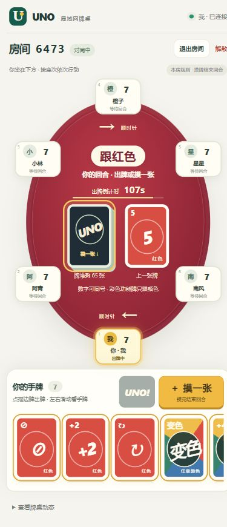

# UNO · 局域网牌桌

一个能直接运行的 Web UNO 基础版：一台电脑启动 Node.js，同局域网的朋友用浏览器加入房间。

完整设计与后续计划见 [DESIGN.md](DESIGN.md)。

公网 Docker 部署请按 [阿里云 Ubuntu 逐步部署手册](docs/PUBLIC_DEPLOYMENT_GUIDE.md) 操作；项目已包含 Dockerfile 和 Compose 配置。

更新代码后请先停止原服务，再运行 `npm start`，所有设备刷新页面并重新建房。网页资源在服务启动时加载，单独刷新网页不会加载尚未重启的服务端版本。

手机圆桌预览：



## 快速开始

需要 **Node.js 24 或更新版本**。在当前项目目录执行：

```powershell
npm ci
npm start
```

依赖已经安装过时，直接 `npm start` 即可。Windows 推荐双击 `start.bat`：缺少依赖时会自动安装，服务启动成功后会自动打开默认浏览器中的电脑端管理入口。

项目自带 `.npmrc`，把 npm 缓存放在当前目录的 `.npm-cache`，并使用官方包仓库。无需修改全局 npm 配置或升级 npm。

启动终端会显示：

```text
本机管理：http://localhost:3000/
局域网：http://你的内网IP:3000
```

1. 主机浏览器自动打开本机管理入口，输入昵称，创建房间。
2. 朋友打开终端显示的**局域网地址**，输入自己的昵称和 4 位房间号。
3. 至少 2 人在线时，房主开始游戏。
4. 本局结束后，房主返回大厅即可再开一局。

### 电脑只开服务器，自己用手机玩

创建房间前取消勾选 **「房主参与游戏」**；也可在等待大厅中修改这个开关。

- 电脑上的房主只管理和旁观，不占 2～10 个玩家席位、不发牌、不参与回合。
- 自己和朋友分别用手机打开主机的局域网地址，以玩家身份加入同一房间。实际参赛玩家至少 2 人才能开局。
- 电脑上的房主仍可开始游戏、移交房主、解散房间和在结算后返回大厅。开局后不能切换参与状态。
- 房主网页离线或退出不会影响正在进行的对局，管理权限会移交给其他在线成员；只有实际参赛玩家掉线才暂停游戏。移交管理权限不会自动改变任何人的参赛状态。
- **电脑上的 Node.js 进程仍要保持运行。** 关闭网页可以继续玩，关闭服务终端、让电脑休眠或关机则所有设备都会断线。

其他设备不能使用主机的 `localhost` 或 `127.0.0.1`。如果启动时显示多个网卡地址，选择真实 WiFi/以太网连接的 IPv4；可通过 `ipconfig` 确认。

首次安装依赖需要网络，运行游戏不需要互联网，页面没有 CDN、外部字体或在线资源。

### 房间语音聊天

大厅和对局页面都有独立的麦克风、听筒开关，默认均关闭，语音与游戏音效的静音设置互不影响。

- 点击“开启麦克风”，允许浏览器的麦克风权限，即可说话，同时默认开启听筒；之后两个开关可以分别控制。
- 只点击“开启听筒”可以听朋友说话，不会申请录音权限。关麦后仍可继续收听；关听筒时仍可保持麦克风发送。
- 语音只在当前房间成员之间传输，仅管理的房主和已完赛玩家也可使用。开始游戏、返回大厅不打断语音。
- 离房、解散、断线、刷新或被新标签接管时会停止录音并关闭语音连接；重新连接后需自行开启，避免自动录音。
- 如果浏览器阻止播放，点击控制条中的“恢复收听”。麦克风权限被拒绝不影响已有的收听，也不影响出牌。

**手机通过普通 HTTP 局域网地址访问时，浏览器不允许开启麦克风，必须使用可信的 HTTPS。电脑上的 `http://localhost` 通常允许录音，但其他设备不能用这个地址连接主机。**

局域网 Windows 启动方式：

1. 停止原服务，双击 [start-https.bat](start-https.bat)。需要 OpenSSL；安装了 Git for Windows 的电脑通常已经具备，脚本也支持 PATH 中的 OpenSSL。
2. 脚本在项目 `.certs` 目录生成本地 CA 和服务器证书，默认启动 `https://电脑IP:3443`。不会自动修改电脑或手机的证书信任设置。
3. 把 **`.certs/lan-uno-ca.crt` 公共证书**传到自己的设备并安装信任。仅信任你自己生成的证书，不要传出或安装任何 `.key` 文件。私钥目录已从 Git 和 Docker 构建中排除。
4. Windows：双击 CA 证书，将其导入“当前用户 → 受信任的根证书颁发机构”。iPhone：安装证书描述文件后，到“设置 → 通用 → 关于本机 → 证书信任设置”启用完全信任。Android：在“安全/加密与凭据 → 安装证书 → CA 证书”中安装，具体名称因系统而异。
5. 用浏览器打开终端输出的 **HTTPS 局域网地址**，确认没有证书错误，再加入房间并点击开关。仅点击绕过证书警告，不能保证浏览器授予麦克风权限。允许主机的 TCP 3443 端口，WebRTC 直连也需要设备间的 UDP 通信。

切换热点或网卡导致 IP 改变时，重新运行 `start-https.bat`，脚本会更新服务器证书并保留原 CA；设备通常不需要重新安装根证书。公开 CA 可在 HTTPS 服务的 `/voice-ca.crt` 下载，首次安装也可以直接传文件。

已有可信证书时可以直接设置 `UNO_TLS_CERT`、`UNO_TLS_KEY`，然后运行 `npm start`；默认 HTTPS 端口为 3443，`PORT` 可覆盖。也可以使用配置好 WebSocket 转发的可信 HTTPS 反向代理，并通过 `UNO_ALLOWED_HOSTS` 放行实际域名。

同局域网默认不依赖公网 STUN/TURN。跨公网、不同运营商或热点隔离时，WebRTC 可能无法直连；可通过 `UNO_VOICE_ICE_SERVERS` 配置自己的 STUN/TURN，格式为 JSON 数组，例如：

```powershell
$env:UNO_VOICE_ICE_SERVERS = '[{"urls":"turn:turn.example.com:3478","username":"user","credential":"password"}]'
```

TURN 配置会提供给客户端用于建立连接，请使用受限或短期凭据。浏览器语音使用 WebRTC 加密传输，游戏服务器只转发协商消息，不转发或保存录音。建议使用耳机减少同一空间内的回声；支持的设备会启用回声消除、降噪和自动增益。

### 安装报 EPERM / ENOTEMPTY 怎么办

如果错误包含 `D:\Vue\NodeJs\node_cache`，说明系统的 npm 缓存目录不可写。项目 `.npmrc` 已避开这个目录；确认在本项目目录执行命令。也可显式指定：

```powershell
npm ci --cache .npm-cache --registry=https://registry.npmjs.org/
npm start
```

如果仍报 `node_modules\ws` 的 `ENOTEMPTY`，先在正在运行本游戏的终端按 Ctrl+C 停止服务，再重新执行安装，避免文件正在使用。不需要因为 npm 的“有新版本”通知而执行 `npm install -g npm`，升级 npm 不会解决原缓存目录的权限问题。

如果自动打开浏览器失败，可手动访问终端中的本机管理地址，服务仍会正常运行。仅在不希望打开浏览器的部署中，可用 `node server/index.js --no-open`，或将环境变量 `UNO_OPEN_BROWSER` 设置为 `0`。

如果提示端口已被占用，通常是旧的游戏服务还在运行。先在原服务终端按 Ctrl+C，再重新启动；不要同时开两个使用相同端口的服务。

## 已实现

- 原生 HTML/CSS/JavaScript，Node.js + ws；HTTP 与 WS 共用端口。
- 昵称、随机恢复令牌、刷新重连、同浏览器新标签接管。
- 4 位编号房间，2～10 人，人数设置、房主移交、退出和解散。
- 房主可选择是否参赛；仅管理模式支持额外容纳 10 名实际玩家。
- 经典 108 张牌，每人初始 7 张；数字、跳过、反转、+2、变色和 +4。
- 本房规则：数字牌同色或同数字；彩色功能牌只跟当前颜色，黑色牌可跨色。保留双人规则与特殊起始牌处理。
- 主动摸一张后立刻结束回合，不允许立即打出新牌，没有跳过／弃牌操作；内部弃牌堆正常回收洗混。
- 剩一张牌自动 UNO、语音播报与动画提示，无需手动操作；已移除抓漏及漏喊处罚。
- +4 冒险使用、接受或质疑；证据只发给质疑者。
- 逐名完赛，已完赛玩家退出轮转，直到仅剩一人再显示完整排名、返回大厅。
- 服务端出牌倒计时：默认 45 秒，房主在大厅可设 15～120 秒；超时自动摸一张并结束回合。
- 私有手牌视图、命令校验、请求去重、消息限速、心跳。
- 短暂掉线暂停与恢复、60 秒超时处理。
- 手机优先圆桌：自己固定下方，按座次围坐，当前玩家发光高亮，上下箭头显示方向。
- 慢速摸牌／出牌飞牌动画（单张约 1 秒），UNO 与回合提示，跳过／+2 座位印章，变色／+4 中央特效；每回合预留 2.2 秒动画缓冲。
- 牌桌随生效颜色切换为红／黄／绿／蓝，大号摸牌按钮，手机横向手牌。

## 规则与产品约定

- 一次出一张，不叠加 +2/+4，不抢出，不使用 7/0 换手。
- 数字牌可以同色或同数字；彩色跳过、反转、+2 必须同当前颜色，不能用蓝反转接黄反转。黑色变色／+4 可跨色，+4 合法性与质疑另行结算。
- 有可出牌时也能主动摸牌；摸一张后结束回合，即使新牌可出也必须等下次。没有直接跳过／弃牌按钮。
- 出牌后剩一张牌时自动声明 **UNO**，播放语音并显示动画，无需手动点击。没有抓漏或漏喊罚牌。
- +4 只在手中没有当前颜色时合法；允许冒险出牌，由后继玩家决定是否质疑。质疑成功出牌者抽 4，失败质疑者抽 6 并跳过。
- 按出完手牌顺序记录名次；第一名产生后其他人继续，只剩最后一位未完赛玩家时全局结束。最后一张 +4 等接受／质疑结算后记录名次。
- 未完赛玩家主动退出或掉线超过 60 秒，本局中止。其短暂离线会冻结计时，重连后恢复剩余秒数。已完赛／仅管理／旁观成员离线或退出不影响继续游戏；已完赛座位保留姓名、名次。房主离线自动移交管理权。
- 默认每回合 45 秒（可在大厅设为 15～120）。普通回合超时自动摸一张并结束；起始选色超时自动选色、摸一张并结束；+4 回应超时接受四张罚牌并跳过。自动 UNO 不重置倒计时。服务端处理超时，关掉网页后台计时也不影响规则。
- 极端情况下没有可抽的牌，只抽实际可用数量并结束当前回合，不提前判平局；仍须玩到只剩一人。可以正常出牌后再回收弃牌。
- 单局模式不累计 500 分。服务重启后所有房间清空。
- 同浏览器配置文件、同网站来源共用身份。新标签页会接管旧连接；不同浏览器、无痕窗口或不同主机地址视为独立身份。单机体验两人时可使用两个浏览器，或普通/无痕窗口。

## 局域网与防火墙

Windows 查看内网地址：

```powershell
ipconfig
```

如果其他设备无法访问，请确认主机和玩家处于可互通的网络。访客 WiFi、AP 隔离、VPN 和公司网络 ACL 都可能阻止互访。

管理员 PowerShell 可对受信任的专用网络放行游戏端口：

```powershell
New-NetFirewallRule -DisplayName 'LAN UNO TCP 3000' -Direction Inbound -Action Allow -Protocol TCP -LocalPort 3000 -Profile Private -RemoteAddress LocalSubnet
```

此命令需由你按实际网络情况执行，项目不会自动修改防火墙。保持主机开机、唤醒并运行服务。基础版通过 HTTP/WS 通信，适用于受信任的局域网。

修改端口：

```powershell
$env:PORT = '3001'
npm start
```

服务器接受本机 IPv4、localhost、本机名作为 Host。使用额外的内网 DNS 名称时，可显式设置逗号分隔的主机名（不含协议或端口）：

```powershell
$env:UNO_ALLOWED_HOSTS = 'uno.home,my-pc.local'
npm start
```

IP 或网卡改变后重启服务，更新允许地址。跨网段需要网络路由和防火墙策略支持；应用不会主动发现或打通其他子网。

## 验证

```powershell
npm test
```

目前 **45 项自动化测试通过**，包括：

- 牌组分布、匹配、双人功能牌、抽牌限制、罚牌与胜负。
- UNO 声明去重、移除抓漏／跳过命令、+4 合法性/质疑/私有证据、弃牌回收和总量守恒。
- 多轮 2/3/10 人自动模拟对局。
- 超时边界与重复扫描、动画缓冲、断线计时冻结／恢复、完赛后离线不影响对局、逐名排名与最后一张功能牌结算。
- 真实 HTTP/WebSocket 下的完整对局、10 客户端隔离、权限和去重。
- 断线暂停、令牌恢复、标签接管、超时中止、Host/Origin 和非法输入。
- 房主参与开关、席位计数、至少两名实际玩家、仅管理视图与操作拦截。
- 管理房主 + 10 名玩家、房主不参赛的完整对局、房主掉线／退出不影响游戏。
- 2～10 人各自视角固定底部、座次一致、动画事件编号与处罚目标、摸牌后不能出牌、彩色功能牌不能跨色。

测试会使用本机临时 TCP 端口，运行环境需要允许 loopback 连接。

另已在浏览器检查首页、双玩家建房加入、开始发牌和对战页面。手机尺寸的页面宽度已检查；不同型号手机与真实跨设备 WiFi/防火墙验收仍需要在你的网络中完成。自动测试不能替代这些物理网络检查。

## 源码结构

```text
server/index.js       HTTP 静态托管、WS、Host/Origin、限速与心跳
server/rooms.js       玩家会话、房间、重连、去重、私有视图
server/game.js        108 张牌和纯规则引擎
public/index.html    首页、大厅、牌桌和对话框
public/styles.css    本地样式与响应式布局
public/game.css      手机优先圆桌、座位高亮、四色牌桌与动画样式
public/effects.js    飞牌、印章、变色/+4 特效及回合/UNO 提示
public/sounds.js     出牌/特殊牌合成音效、UNO 语音和静音设置
public/audio/uno.wav 离线 UNO 语音
public/audio/victory.wav 离线 Victory 胜利语音
public/table-layout.js 圆桌视角与固定座次计算
public/hand-layout.js 自适应扇形手牌布局与最小可见间距
public/voice.js      麦克风/听筒开关、WebRTC 协商和录音释放
server/voice.js      房间语音成员、信令校验与转发
start-https.bat      Windows 局域网语音 HTTPS 启动入口
public/app.js        WS 客户端、状态渲染和交互
tests/               规则与真实联机测试
DESIGN.md            13 章完整设计和过程计划
```

开发时 `npm run dev` 监听服务端模块。静态资源在启动时读取，改动 HTML/CSS/前端 JS 后需重启服务并刷新浏览器。重启会清空房间。

## 游戏音效

手牌使用自适应扇形排列：少量牌居中展开，手牌多时降低弧度并横向滚动，保留牌面大小和至少 48px 的相邻位置间距。鼠标悬停或键盘聚焦可抬起查看牌面。手机和桌面分别使用适合的牌面尺寸；较矮屏幕不固定手牌面板，避免遮住牌桌。

首位玩家出完手牌并完成最后一张牌的罚牌结算后，播放选定的 “Victory!” 胜利语音一次；后续名次与最终排名不会重复播放。胜利语音与其他音效共用顶部静音开关，后台标签页和重连恢复不会补播。

普通出牌、跳过、反转、+2、变色和 +4 均有对应音效，摸牌及接受/质疑 +4 后的抽牌也有提示。玩家出牌后只剩一张牌时自动播放 UNO 语音；服务端同时自动声明 UNO，所有在线前台玩家都会收到动画和语音提示，无需手动操作，同一次剩一张牌期间不会重复播报。

顶部“音效：开/关”可随时静音，并记住当前浏览器的选择。浏览器要求先点击页面或使用键盘才能启用声音；后台标签页不播放，也不会在切回时补播。音效使用 Web Audio 合成，UNO 使用随项目提供的本地 WAV，不需要联网或新增依赖。语音资源加载失败时降级为短提示音，音频不可用不影响游戏。

## 后续再加

积分赛、聊天/表情、机器人、公开观战、密码、可配置规则和持久化存档。
